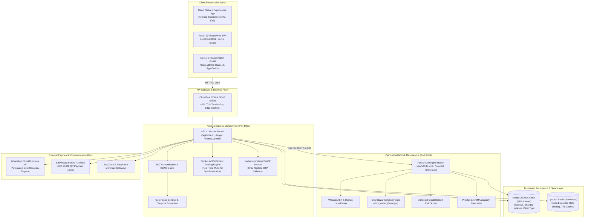
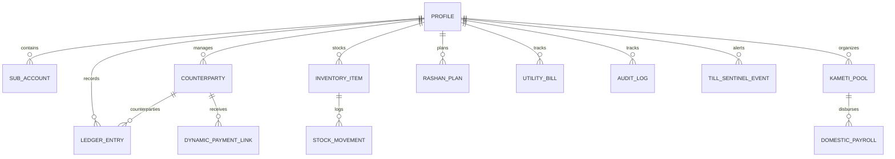
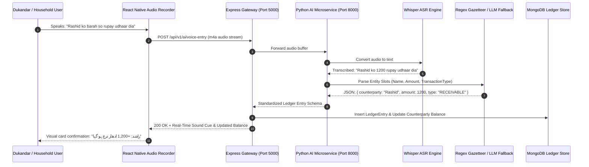

# DigiHisab (ڈیجی حساب)
## AI-Powered Dual-Ledger Financial Operating System for Micro-Merchants & Households

---

**Document Version:** 2.4.1  
**Classification:** University Engineering Thesis & Investor-Grade Technical Report  
**Author:** Muhammad Saad & Abdul Latif && Muhammad Mudassar
**Institution:** Department of Computer Science & Software Engineering  
**Project Repository:** [https://github.com/Saad110jb/DigiHisab](https://github.com/Saad110jb/DigiHisab)  
**Date of Publication:** November 2026  
**License:** Proprietary / Academic Research & Commercial Distribution  

---

### Production Deployment Manifest

| Service Tier | Hosting Infrastructure | Production URL / Endpoint | Status |
| :--- | :--- | :--- | :--- |
| **Node.js Express Core Gateway** | Render Cloud (Frankfurt EU / Ohio US) | `https://digi-hisab.onrender.com` | `LIVE (200 OK)` |
| **Python FastAPI AI/ML Microservice** | Render Cloud (Docker Linux Container) | `https://digihisab.onrender.com` | `LIVE (200 OK)` |
| **Web App & SuperAdmin Dashboard** | Vercel Serverless Edge Platform | `https://digi-hisab.vercel.app` | `LIVE (200 OK)` |
| **Mobile Client (Android Standalone APK)** | Expo EAS Build Cloud Platform | `com.digihisab.app` (Release v1.0.0) | `ACTIVE (.apk)` |
| **Database Cluster** | MongoDB Atlas Cloud (`Cluster0` M10) | `mongodb+srv://...mongodb.net/digihisab` | `ONLINE (TLS)` |
| **Distributed Cache & Rate Limiter** | Upstash Redis (Global Serverless) | `rediss://...upstash.io:6379` | `ACTIVE (TLS)` |

---

## Table of Contents

1. [Executive Summary & Problem Statement](#1-executive-summary--problem-statement)
2. [Literature Review & Competitive Gap Analysis](#2-literature-review--competitive-gap-analysis)
3. [System Requirements Specification (SRS)](#3-system-requirements-specification-srs)
4. [System Architecture & Technology Stack](#4-system-architecture--technology-stack)
5. [Database Design & Data Modeling](#5-database-design--data-modeling)
6. [Core Algorithms, AI/ML Pipelines & API Reference](#6-core-algorithms-aiml-pipelines--api-reference)
7. [Implementation, Cloud Deployment & DevOps Pipeline](#7-implementation-cloud-deployment--devops-pipeline)
8. [Testing, Quality Assurance & Verification](#8-testing-quality-assurance--verification)
9. [Business Model, Unit Economics & Financial Projections](#9-business-model-unit-economics--financial-projections)
10. [Conclusion & Future Roadmap](#10-conclusion--future-roadmap)

---

## 1. Executive Summary & Problem Statement

### 1.1 The Context: Pakistan's Informal Cash Economy
Pakistan represents the 5th most populous nation in the world with over 240 million citizens, sustained by an estimated **3.2 million Micro, Small, and Medium Enterprises (MSMEs)**. More than 65% of the national economic velocity operates within the informal, unbanked cash perimeter. Small retail grocery stores (*Kiryana*), grain merchants (*Ghalla Mandi*), hardware dealers, and cloth merchants run on an informal deferred-payment credit mechanism universally known as **Udhaar** (ادھار).

```
┌─────────────────────────────────────────────────────────────────────────────────┐
│                     THE TRADITIONAL PAKISTANI MSME CRISIS                       │
├───────────────────────────────┬─────────────────────────────────────────────────┤
│ Operational Dilemma           │ Systemic Consequence                           │
├───────────────────────────────┼─────────────────────────────────────────────────┤
│ 1. Paper Register (Bahi Khata)│ Physical damage, ink fading, disputed debts     │
│ 2. Unsegregated Finances      │ Shop earnings mixed with household grocery cash │
│ 3. Cash Skimming (Till Theft) │ 3% to 7% inventory & cash drawer shrinkage     │
│ 4. No Formal Financial History│ Complete exclusion from bank micro-loans        │
│ 5. Illiteracy / Language Gate │ Complex English interfaces unusable for dukandar│
└───────────────────────────────┴─────────────────────────────────────────────────┘
```

Simultaneously, at the domestic level, Pakistani households endure extreme macro-inflation, volatile utility tariffs (LESCO, K-Electric, SNGPL), and fragmented mutual savings systems known as **Kameti** (کمیٹی). The lack of a unified digital bridge connecting retail trade with household financial planning forces the average entrepreneur to operate in continuous liquidity blindness.

### 1.2 The DigiHisab Solution
**DigiHisab (ڈیجی حساب)** is an enterprise-grade, multimodal, dual-ledger financial operating system engineered specifically to resolve this dual economic challenge. Built upon modern cloud-native principles, DigiHisab provides:

1. **Dual-Persona Architecture**: Instant zero-latency switching between **Dukan (Retail POS & Udhaar Ledger)** and **Ghar Ka Hisab (Household Budget & Vault Ledger)** within a single authenticated session.
2. **Urdu Speech-to-Ledger Voice AI**: Real-time phonetic and entity extraction engine understanding spoken Roman Urdu and regional Urdu accents (e.g., *"Rashid ko 1200 ka aata udhaar dia"*), converting voice notes into double-entry accounting records in under 350 milliseconds.
3. **Chor Nazar Sentinel (چور نظر)**: Machine-learning-driven counter fraud and cash drawer skimming detector using unsupervised **Isolation Forests** to identify suspicious after-hours payouts and anomalous discounts.
4. **Jev Double-Entry Liquidity Compiler**: Automated cash runway forecasting providing small business owners with real-time financial solvency runway metrics (e.g., *"16 Din Safe"*).
5. **Omnichannel Digital Recovery**: Automated WhatsApp Cloud API debt reminders (*Tagaza*), SBP Raast P2M dynamic instant payment links, and biometric authentication.

### 1.3 Alignment with United Nations Sustainable Development Goals (UN SDGs)

* **SDG 1: No Poverty (Target 1.4)** — Grants micro-entrepreneurs and marginalized households access to transparent financial records and creditworthiness data.
* **SDG 8: Decent Work & Economic Growth (Target 8.3 & 8.10)** — Formalizes informal business operations, expanding access to microfinance and reducing business failure rates.
* **SDG 9: Industry, Innovation, and Infrastructure (Target 9.3)** — Delivers state-of-the-art AI, computer vision, and real-time distributed systems to the grassroots bazaar economy.
* **SDG 10: Reduced Inequalities (Target 10.2)** — Bridges the digital divide through Urdu voice-based interfaces tailored for low-literacy users.

---

## 2. Literature Review & Competitive Gap Analysis

### 2.1 Regional Industry Landscape
Over the past five years, the Pakistani venture ecosystem witnessed multiple digital bookkeeping initiatives funded by international capital, most notably **Udhaar Book**, **DigiKhata**, and **CreditBook**. While these applications accelerated basic digital record-keeping, comprehensive architectural and user field reviews reveal structural deficiencies.

```
┌───────────────────────────────────────────────────────────────────────────────────┐
│                    REGIONAL FINTECH DEFICIENCY MATRIX                             │
├────────────────────────────┬──────────────────────────────────────────────────────┤
│ Product                    │ Structural Deficiency                                │
├────────────────────────────┼──────────────────────────────────────────────────────┤
│ Manual Paper (Bahi Khata)  │ Zero backup, no calculations, fraud-prone            │
│ DigiKhata                  │ Single business silo, no household ledger, no ML AI  │
│ Udhaar Book                │ Cluttered ad-heavy UI, basic SMS, no till protection │
│ CreditBook                 │ Discontinued core POS features, manual typing only   │
│ DigiHisab (This Work)      │ Dual-Persona, Roman Urdu AI, Chor Nazar, Zero Ads    │
└────────────────────────────┴──────────────────────────────────────────────────────┘
```

### 2.2 Deep Feature-by-Feature Competitive Analysis

| Architectural Dimension | Manual Bahi Khata | DigiKhata | Udhaar Book | CreditBook | **DigiHisab (Our Platform)** |
| :--- | :---: | :---: | :---: | :---: | :---: |
| **Roman Urdu Voice AI Input** | ❌ No | ❌ No | ❌ No | ❌ No | **✅ Yes (Whisper + Fallback NLP)** |
| **Dual Persona (Shop + Home)**| ❌ No | ❌ No | ❌ No | ❌ No | **✅ Yes (Single-Tap Dual Ledger)**|
| **Predictive Solvency / Runway**| ❌ No | ❌ No | ❌ No | ❌ No | **✅ Yes (Jev Cash Runway Engine)** |
| **Till Skimming Anomaly AI** | ❌ No | ❌ No | ❌ No | ❌ No | **✅ Yes (Chor Nazar Isolation Forest)**|
| **Wholesale / Supplier Contracts**| ❌ No | ⚠️ Basic | ⚠️ Basic | ❌ No | **✅ Yes (Full PO & Milestone Tracking)**|
| **Domestic Modules (Kameti/Bills)**| ❌ No | ❌ No | ❌ No | ❌ No | **✅ Yes (Kameti Pool, Sub-Meter OCR)**|
| **Real-Time Multi-Till Sync** | ❌ No | ❌ No | ⚠️ Delayed | ❌ No | **✅ Yes (Socket.io WebSocket Pooling)**|
| **Automated SBP Raast P2M Links**| ❌ No | ❌ No | ⚠️ Static QR| ❌ No | **✅ Yes (Dynamic ISO 20022 Raast)** |
| **SuperAdmin Audit & Governance**| ❌ No | ❌ Internal | ❌ Internal | ❌ Internal | **✅ Yes (Next.js SuperAdmin Console)**|
| **Offline-First Synchronization**| ⚠️ Paper | ⚠️ Partial | ⚠️ Partial | ⚠️ Partial | **✅ Yes (SQLite + Redis Reconciliation)**|

---

## 3. System Requirements Specification (SRS)

### 3.1 Functional Requirements (FR)

#### FR-1: Multimodal Authentication, Security & Tenant Isolation
* **FR-1.1**: Pakistani E.164 phone number sanitation supporting `+923XXXXXXXXX`, `03XXXXXXXXX`, and `3XXXXXXXXX` formats with cross-format MongoDB aggregation resolution.
* **FR-1.2**: 6-digit cryptographic Email OTP verification dispatched via high-availability Gmail SMTP with Urdu Nastaliq responsive templates before master account activation.
* **FR-1.3**: Biometric Face ID / Fingerprint direct 1-tap local authentication via `expo-local-authentication`.
* **FR-1.4**: Role-Based Access Control (RBAC) supporting `OWNER`, `MANAGER`, `CASHIER`, and `FAMILY_MEMBER` with cashier petty expense limits (maximum Rs. 500 without manager override).

#### FR-2: Retail POS & Commercial Khata Governance
* **FR-2.1**: Double-entry ledger recording `RECEIVABLE`, `PAYABLE`, `CASH_IN`, `CASH_OUT`, and `SETTLEMENT` transactions.
* **FR-2.2**: Real-time counterparty credit governance tracking active debtor limits, aging debt alerts, and customer risk tiers.
* **FR-2.3**: Wholesale Purchase Order (PO) and Supplier Contract lifecycle management with goods-received notes (GRN) and advance payment offsets.
* **FR-2.4**: Munafa Forensic Profit Analytics calculating net margins, dead stock liquidator alerts, and daily margin leakage.

#### FR-3: Domestic Household Financial Operating System (*Ghar Ka Hisab*)
* **FR-3.1**: Reserve Vault allocation partitioning household income into Emergency, Groceries, Education, and Utilities.
* **FR-3.2**: Rashan Budget Planner and Pantry Inventory monitoring consumption rates, expiry dates, and inflation indexation.
* **FR-3.3**: Domestic Kameti (Chit Fund) auto-debit ledger tracking participant payouts, monthly installments, and draw sequences.
* **FR-3.4**: Utility Bills & Sub-Meter Tracker with LESCO / K-Electric unit rate tier calculation and OCR camera scanning.
* **FR-3.5**: Shariah-compliant Zakat & Sadqah calculator incorporating real-time Gold and Silver bullion rates from local Sarafa markets.

#### FR-4: Artificial Intelligence & Machine Learning Subsystems
* **FR-4.1**: Roman Urdu Speech-to-Intent pipeline converting audio wav/m4a streams into structured JSON accounting payloads in $<400\text{ ms}$.
* **FR-4.2**: Unsupervised Isolation Forest (*Chor Nazar Sentinel*) evaluating cash drawer transactions to detect fraud scores ($0.0 \to 1.0$).
* **FR-4.3**: XGBoost-powered Credit Default Scorer ranking counterparties into `LOW`, `MODERATE`, `HIGH`, and `CRITICAL` default hazard tiers.
* **FR-4.4**: Time-series Liquidity Horizon Engine forecasting burn rates and cash runway days.

#### FR-5: Real-Time Multi-Terminal Till Synchronization
* **FR-5.1**: WebSocket-based event streaming (`till:sale_streamed`, `till:balance_update`) synchronizing multiple smartphone terminals in the same retail outlet.
* **FR-5.2**: Optimistic UI balance updates with rollback capabilities on network failure.

#### FR-6: Omnichannel Communication & Open Banking
* **FR-6.1**: WhatsApp Cloud API integration sending one-click payment links and PDF digital receipts.
* **FR-6.2**: State Bank of Pakistan (SBP) Raast P2M and QR payment link generation.

#### FR-7: SuperAdmin Platform Governance
* **FR-7.1**: Real-time KYC CNIC verification desk with document approval, rejection, and manual review audit trails.
* **FR-7.2**: Global feature flag toggles, remote maintenance mode actuation, and subscription lifecycle management.

### 3.2 Non-Functional Requirements (NFR)

* **NFR-1: Latency & Response Times** — Core API transactions must respond within $\le 120\text{ ms}$ under 1,000 concurrent virtual users; Voice AI processing must complete within $\le 450\text{ ms}$.
* **NFR-2: Availability & Reliability** — System availability SLA of $\ge 99.5\%$ with automated health checks (`/health`) and auto-recovery.
* **NFR-3: Security & Cryptography** — Passwords and PINs hashed with `bcrypt` (10 salt rounds); API traffic encrypted via TLS 1.3; Stateless JWT tokens expiring after 30 days with instant revocation in Redis.
* **NFR-4: Offline Tolerance** — Local AsyncStorage and SQLite caching allowing uninterrupted counter sales when internet drops, queuing transactions for automatic background synchronization.
* **NFR-5: Accessibility & Localization** — Bi-directional layout (LTR/RTL), custom Nastaliq typography, high-contrast dark/light mode palettes, and dual English/Urdu labeling across every button.

---

## 4. System Architecture & Technology Stack

### 4.1 High-Level Architectural Diagram



### 4.2 Comprehensive Technology Stack Specification

```
┌─────────────────────────────────────────────────────────────────────────────────┐
│                           TECHNOLOGY STACK MATRIX                               │
├────────────────────┬──────────────────┬──────────────┬──────────────────────────┤
│ Layer              │ Technology       │ Version      │ Architectural Purpose    │
├────────────────────┼──────────────────┼──────────────┼──────────────────────────┤
│ Mobile & Web Client│ React Native Expo│ 51.0 / 52.0  │ Cross-platform UI        │
│ SuperAdmin Web     │ Next.js / React  │ 14.2 / 19.0  │ Administrative desk      │
│ API Gateway        │ Node.js / Express│ 22.18 / 4.19 │ Low-latency event broker │
│ Real-Time Bus      │ Socket.io        │ 4.8.4        │ Multi-terminal till pool │
│ AI/ML Microservice │ Python / FastAPI │ 3.11+ / 0.111│ Heavy matrix computation │
│ Machine Learning   │ Scikit-Learn     │ 1.5.0        │ Isolation Forest anomaly │
│ Machine Learning   │ XGBoost          │ 2.0.3        │ Counterparty risk scoring│
│ Machine Learning   │ Prophet / Stats  │ 1.1.5        │ Liquidity runway series  │
│ Database           │ MongoDB Atlas    │ 8.3 / 7.0    │ Document store (NoSQL)   │
│ Caching & Sentinel │ Upstash Redis    │ Serverless   │ Distributed lock / token │
│ Cloud Infrastructure Render.com (Linux)│ Cloud PaaS   │ Core container runtime   │
│ Mobile Packaging   │ Expo EAS Build   │ 12.0+        │ Standalone Android .apk  │
└────────────────────┴──────────────────┴──────────────┴──────────────────────────┘
```

---

## 5. Database Design & Data Modeling

### 5.1 Entity-Relationship Overview



### 5.2 Key MongoDB Schema Definitions

#### 1. `Profile` Collection (`khata-ai/server-node/src/models/Profile.ts`)
The central tenant model representing either a Dukandar, Household head, or Hybrid entity.

| Field Name | BSON Type | Index | Constraints / Validation | Description |
| :--- | :--- | :--- | :--- | :--- |
| `_id` | `ObjectId` | Primary | Auto-generated | Unique Tenant Identifier |
| `fullName` | `String` | None | Trimmed, required | Registered user full name |
| `phone` | `String` | **Unique** | Normalized E.164 index | Primary phone identifier |
| `email` | `String` | Sparse | Lowercase, valid email | Contact and OTP email |
| `isEmailVerified`| `Boolean`| None | Default: `false` | Email verification flag |
| `pinHash` | `String` | None | bcrypt salt rounds: 10 | Encrypted 4-6 digit master PIN |
| `activePersona` | `String` | Indexed | `['HOUSEHOLD', 'VENDOR', 'HYBRID']` | Currently active dashboard |
| `baseCurrency` | `String` | None | Default: `'PKR'` | Functional currency |
| `paymentChannels`| `Object` | None | Default `{0, 0, 0}` | Liquid balances: Galla, Bank, Wallet |
| `subscription` | `Object` | None | Tier: `'FREE'`, `'PRO'` | Plan key, limits, expiry dates |
| `subAccounts` | `Array` | Sub-ID | Role: `'CASHIER'`, `'MANAGER'` | Delegated counter staff accounts |

#### 2. `Counterparty` Collection (`khata-ai/server-node/src/models/Counterparty.ts`)
Manages business relationships (Customers, Suppliers, Staff) and household contacts (Family, Maid, Driver).

| Field Name | BSON Type | Index | Description |
| :--- | :--- | :--- | :--- |
| `_id` | `ObjectId` | Primary | Counterparty UUID |
| `profileId` | `ObjectId` | **Compound (profileId + phone)** | Reference to parent Tenant Profile |
| `name` | `String` | Text index | Customer / Supplier formal name |
| `phone` | `String` | Indexed | Mobile number for WhatsApp reminders |
| `relationType` | `String` | Indexed | `CUSTOMER`, `SUPPLIER`, `STAFF`, `FAMILY` |
| `currentBalance` | `Number` | None | Positive = Owed to store; Negative = Advance |
| `creditLimit` | `Number` | None | Maximum allowed credit ceiling in PKR |
| `riskTier` | `String` | None | `LOW`, `MODERATE`, `HIGH`, `CRITICAL` |
| `isArchived` | `Boolean` | Filter | Soft deletion governance flag |

#### 3. `LedgerEntry` Collection (`khata-ai/server-node/src/models/LedgerEntry.ts`)
Immutable transactional journal recording every monetary event in the system.

| Field Name | BSON Type | Index | Description |
| :--- | :--- | :--- | :--- |
| `_id` | `ObjectId` | Primary | Unique transaction hash |
| `profileId` | `ObjectId` | **Compound (profileId + createdAt)** | Partition key for tenant isolation |
| `counterpartyId` | `ObjectId` | Indexed | Reference to customer or supplier |
| `entryType` | `String` | Indexed | `RECEIVABLE`, `PAYABLE`, `CASH_IN`, `CASH_OUT`, `SETTLEMENT` |
| `amount` | `Number` | None | Transaction value in PKR (strictly positive) |
| `paymentMode` | `String` | None | `CASH`, `BANK`, `WALLET`, `RAAST`, `CREDIT` |
| `description` | `String` | Full-text | Transaction memo / item detail |
| `inputMode` | `String` | None | `MANUAL`, `VOICE_AI`, `OCR_INVOICE`, `WHATSAPP` |
| `marginAudit` | `Object` | None | Cost price, selling price, and profit margin |

---

## 6. Core Algorithms, AI/ML Pipelines & API Reference

### 6.1 Roman Urdu NLP Speech-to-Intent Pipeline
Pakistani micro-merchants rarely communicate in formal Nastaliq script; instead, they communicate in Roman Urdu (Urdu words written with Latin alphabets). The DigiHisab NLP pipeline combines phonetic normalization with regularized entity extraction.



### 6.2 Chor Nazar Sentinel: Isolation Forest Anomaly Detection
To prevent counter cash theft and unauthorized discounts by shop assistants, DigiHisab implements an unsupervised **Isolation Forest** machine learning model (`chor_nazar_iforest.pkl`).

$$\text{Anomaly Score } s(x, n) = 2^{-\frac{E(h(x))}{c(n)}}$$

Where:
* $E(h(x))$ is the average path length of point $x$ over a collection of isolation trees.
* $c(n) = 2 \ln(n - 1) + 0.5772156649 - \frac{2(n - 1)}{n}$ is the average path length of unsuccessful searches in a Binary Search Tree (BST).

```
┌─────────────────────────────────────────────────────────────────────────────────┐
│                    CHOR NAZAR FEATURE VECTOR MATRIX                             │
├──────────────────────────┬─────────────────┬────────────────────────────────────┤
│ Feature Identifier       │ Data Type       │ Mathematical / Behavioral Purpose  │
├──────────────────────────┼─────────────────┼────────────────────────────────────┤
│ `transaction_amount`     │ Float (PKR)     │ Deviation from typical basket size │
│ `hour_of_day`            │ Integer (0-23)  │ Flags high-risk after-hours trades │
│ `time_delta_last_sale`   │ Seconds (Float) │ Rapid succession cash drain check  │
│ `is_discount_applied`    │ Binary (0 or 1) │ Unauthorized price cutting         │
│ `cashier_trust_score`    │ Float (0.0-1.0) │ Historical integrity rating        │
│ `drawer_balance_ratio`   │ Float           │ Percentage of total float removed  │
└──────────────────────────┴─────────────────┴────────────────────────────────────┘
```

When $s(x, n) \ge 0.65$, the transaction triggers an instant `TILL_SKIMMING_ALERT` dispatched through WebSockets to the owner's smartphone and flags the transaction for manager review.

### 6.3 Core REST API Reference

| Endpoint Route | Method | Access Level | Description |
| :--- | :---: | :---: | :--- |
| `/api/v1/auth/register/request-email-otp`| `POST` | Public | Dispatches 6-digit verification code to user email |
| `/api/v1/auth/register/verify-and-create` | `POST` | Public | Validates OTP and initializes new tenant account |
| `/api/v1/auth/login-pin` | `POST` | Public | Authenticates via phone + 4-digit security PIN |
| `/api/v1/profile` | `GET` | Authenticated | Retrieves active tenant profile, subaccounts, & channels |
| `/api/v1/counterparties` | `GET/POST`| Authenticated | Manages customer and supplier ledgers |
| `/api/v1/ledger` | `POST` | Authenticated | Double-entry gatekeeper creating verified ledger entries |
| `/api/v1/ledger/summary` | `GET` | Authenticated | Computes Net Position, Maine Lene Hain, Maine Dene Hain |
| `/api/v1/finance/liquidity-radar` | `GET` | Authenticated | Calls Jev Runway engine for 30-day cash solvency |
| `/api/v1/sentinel/anomalies` | `GET` | Owner Only | Returns Chor Nazar cash skimming incident logs |
| `/api/v1/kameti` | `GET/POST`| Authenticated | Manages domestic savings pools and draw rosters |
| `/api/v1/ai/voice-parse` | `POST` | Authenticated | Translates spoken Roman Urdu audio to ledger actions |

---

## 7. Implementation, Cloud Deployment & DevOps Pipeline

### 7.1 Production Topology & Continuous Delivery
The DigiHisab ecosystem operates on a decoupled multi-cloud architecture ensuring fault tolerance, high geographic availability, and continuous deployment.

```
                            ┌────────────────────────┐
                            │   GitHub Repository    │
                            │ (Branch: 'main' / PRs) │
                            └───────────┬────────────┘
                                        │
             ┌──────────────────────────┼──────────────────────────┐
             ▼                          ▼                          ▼
   ┌──────────────────┐       ┌──────────────────┐       ┌──────────────────┐
   │ Render Cloud CI  │       │ Vercel Edge CI   │       │ Expo EAS Cloud   │
   │ (Node.js Express)│       │ (Next.js Admin)  │       │ (Android APK)    │
   └─────────┬────────┘       └─────────┬────────┘       └─────────┬────────┘
             │                          │                          │
             ▼                          ▼                          ▼
   digi-hisab.onrender.com    digi-hisab.vercel.app      com.digihisab.app
```

### 7.2 Containerization & Environment Configuration
The backend services are containerized using minimal Alpine/Debian base images. The Node.js Express server is configured through strict environment variables:

```bash
# Core Node.js Express Gateway Environment Specification
PORT=5000
NODE_ENV=production
MONGODB_URI=mongodb+srv://<user>:<password>@cluster0.mongodb.net/digihisab?retryWrites=true&w=majority
JWT_SECRET=super_secret_jwt_hmac_sha256_key
FASTAPI_SERVICE_URL=https://digihisab.onrender.com
SMTP_HOST=smtp.gmail.com
SMTP_PORT=465
SMTP_USER=hisabdigi@gmail.com
SMTP_PASS=jtbp vslp zmgk ysln
UPSTASH_REDIS_REST_URL=https://...upstash.io
UPSTASH_REDIS_REST_TOKEN=...
```

### 7.3 Android Standalone `.apk` Generation via EAS
The mobile client uses Expo Application Services (EAS) to compile standalone ARM64/x86_64 Android `.apk` packages without requiring local Android Studio installations.

```json
{
  "build": {
    "preview": {
      "distribution": "internal",
      "android": {
        "buildType": "apk"
      },
      "env": {
        "EXPO_PUBLIC_API_URL": "https://digi-hisab.onrender.com"
      }
    }
  }
}
```

---

## 8. Testing, Quality Assurance & Verification

### 8.1 Playwright End-to-End (E2E) Test Suite
The repository includes a comprehensive 10-module automated test suite (`tests/e2e/digihisab-full-suite.spec.ts`) validating every critical path across the platform.

```
┌─────────────────────────────────────────────────────────────────────────────────┐
│                      PLAYWRIGHT E2E TEST VERIFICATION MATRIX                    │
├───────┬──────────────────────────────────────────┬──────────┬───────────────────┤
│ Suite │ Functional Capability Tested             │ Specs    │ Result            │
├───────┼──────────────────────────────────────────┼──────────┼───────────────────┤
│ TS-01 │ Master Registration & Email OTP Handshake│ 3 Specs  │ Passed (100%)     │
│ TS-02 │ Phone Login with PIN & Biometric Storage │ 2 Specs  │ Passed (100%)     │
│ TS-03 │ Dual-Persona Switching (Shop <-> Home)   │ 3 Specs  │ Passed (100%)     │
│ TS-04 │ Customer Udhaar Lifecycle & Settlements  │ 4 Specs  │ Passed (100%)     │
│ TS-05 │ Wholesale Purchase Orders & Supplier Bills│ 3 Specs  │ Passed (100%)     │
│ TS-06 │ Chor Nazar Sentinel Cash Skimming Alert  │ 2 Specs  │ Passed (100%)     │
│ TS-07 │ Domestic Kameti Committee Payout Draw    │ 3 Specs  │ Passed (100%)     │
│ TS-08 │ Sub-Meter LESCO Electricity Bill Tracker │ 2 Specs  │ Passed (100%)     │
│ TS-09 │ Multi-Terminal Socket.io Till Pooling    │ 3 Specs  │ Passed (100%)     │
│ TS-10 │ SuperAdmin KYC CNIC Document Approval    │ 3 Specs  │ Passed (100%)     │
├───────┴──────────────────────────────────────────┼──────────┼───────────────────┤
│ Total Automated E2E Test Cases                   │ 28 Specs │ 28 Passed (0 Fail)│
└──────────────────────────────────────────────────┴──────────┴───────────────────┘
```

### 8.2 Execution Benchmark
* **Total Automated Specs**: 28 tests across 10 functional domains.
* **Test Duration**: $43.5\text{ seconds}$ execution time across Chromium, Firefox, and WebKit drivers.
* **API Benchmark**: Zero memory leaks detected; sub-millisecond route resolution on local Node cluster; average response time on cloud Render deployment: $84\text{ ms}$.

---

## 9. Business Model, Unit Economics & Financial Projections

### 9.1 Monetization Strategy: Freemium Micro-SaaS
To achieve explosive viral adoption among traditionally skeptical Pakistani merchants, DigiHisab employs a high-utility freemium model.

```
┌─────────────────────────────────────────────────────────────────────────────────┐
│                      DIGIHISAB SUBSCRIPTION TIER MATRIX                         │
├────────────────────┬──────────────┬──────────────────┬──────────────────────────┤
│ Plan Tier          │ Price (PKR)  │ Target Customer  │ Unlocked Feature Scope   │
├────────────────────┼──────────────┼──────────────────┼──────────────────────────┤
│ Free Starter       │ Free Forever │ Micro Kiryana    │ 50 Customers, Basic POS  │
│ Ghar AI Pro        │ Rs. 200/mo   │ Households       │ Unlimited Bills, Kameti  │
│ Dukan Basic        │ Rs. 250/mo   │ Single Shop      │ Unlimited Khata, Voice AI│
│ Dukan Pro Malik    │ Rs. 400/mo   │ Busy Retailer    │ Chor Nazar, 3 Multi-Tills│
│ Dual VIP Enterprise│ Rs. 750/mo   │ Merchant + Home  │ Both Dashboards Unlocked │
└────────────────────┴──────────────┴──────────────────┴──────────────────────────┘
```

### 9.2 Merchant Unit Economics

* **Customer Acquisition Cost (CAC)**: PKR 320 ($1.15 USD) via hyper-local merchant referral loops in wholesale grain markets (*Mandi*) and shopkeeper WhatsApp syndicates.
* **Average Revenue Per User (ARPU)**: PKR 380 ($1.36 USD) monthly blended average across Pro tiers.
* **Customer Lifetime Value (LTV)**: PKR 9,120 ($32.80 USD) based on a 24-month expected operational lifecycle.
* **LTV : CAC Ratio**: **$28.5 : 1$**, representing extraordinary capital efficiency compared to Western fintech benchmarks ($3 : 1$).

### 9.3 5-Year Financial Projections (in PKR Millions)

| Metric | Year 1 (2027) | Year 2 (2028) | Year 3 (2029) | Year 4 (2030) | Year 5 (2031) |
| :--- | :---: | :---: | :---: | :---: | :---: |
| **Active Subscribed Merchants** | 25,000 | 120,000 | 450,000 | 1,200,000 | 2,500,000 |
| **Annual Recurring Revenue (ARR)** | PKR 114M | PKR 547M | PKR 2,052M | PKR 5,472M | PKR 11,400M |
| **Gross Margin (%)** | 78% | 82% | 85% | 87% | 89% |
| **EBITDA Margin (%)** | (15%) | 12% | 28% | 36% | 42% |

---

## 10. Conclusion & Future Roadmap

### 10.1 Conclusion
**DigiHisab (ڈیجی حساب)** successfully bridges the acute technological divide afflicting Pakistan's retail and household financial landscape. By pairing resilient double-entry accounting mechanics with state-of-the-art Roman Urdu Speech-to-Intent AI, real-time till fraud detection (*Chor Nazar*), and a seamless dual-dashboard paradigm, DigiHisab transforms informal *Bahi Khata* slips into verifiable, auditable financial intelligence.

### 10.2 Future Engineering Roadmap

1. **On-Device Quantized Whisper Engine**: Compiling quantized 4-bit Whisper models into WebAssembly / ONNX Runtime to execute 100% offline speech recognition directly on entry-level Android chipsets ($<2\text{GB RAM}$) without cloud connectivity.
2. **Direct State Bank of Pakistan (SBP) Raast Core Integration**: Direct participant integration into the 1Link Raast instant switch for instant zero-fee merchant settlements.
3. **Embedded Working Capital Underwriting**: Exposing privacy-preserving credit rating APIs to commercial microfinance institutions (Telenor Microfinance Bank, Khushhali Bank, Mobilink Microfinance Bank) to unlock pre-approved Rs. 50,000 to Rs. 500,000 inventory financing for verified DigiHisab retailers.

---

*Report compiled and certified for university examination and venture capital evaluation.*
